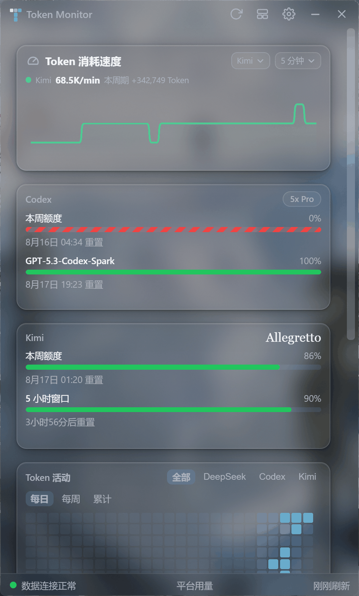
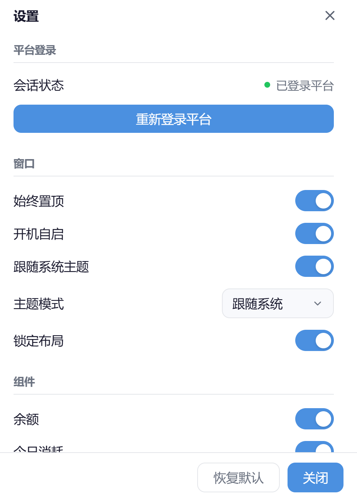

# Token Monitor

[中文](README.md) | **English**

A multi-platform AI usage monitor as a desktop floating widget—track quotas, balances and token consumption for **DeepSeek**, **Codex (OpenAI)** and **Kimi** in one window, with local or pushed **DeepSeek Harness (DSH)** usage included.



## Recent Updates

- **Theme, layout and chart refinements** (2026-10): fixed acrylic switching, text contrast, maximized-window drag restoration and card-height jitter; ECharts now loads on demand, with improved chart updates and resource cleanup.
- **DeepSeek 30-day spending** (2026-10): the balance card now shows spending over the last 30 days, automatically fetching the previous month when the window crosses a month boundary; the cost trend can cover roughly two months.
- **Shen-chan theme and Kimi web quotas** (2026-09): added a character theme with decorations, animated pace-based progress bars and a dedicated mini view; the Kimi web channel reads 5-hour, weekly and monthly quotas.
- **Mini mode and WSL log discovery** (2026-08): added a mini view with balance/quota rings, live rates, paged rotation and an edge-docked speed strip; automatically discovers Kimi session logs in running WSL distributions.
- **Dual-channel DSH collection** (2026-08): supports local telemetry files and Bearer-authenticated push ingestion; auto mode pauses file polling while push is active, and DSH usage feeds the dashboard, heatmap, token-speed card and MCP.

## Features

### Platform Quota Board

- **Codex**: weekly quota and per-model windows (e.g. GPT-5.3-Codex-Spark), plan badge (e.g. `5x Pro`), reset countdown.
- **Kimi**: weekly, 5-hour and monthly quota windows, using the web channel first with CLI credentials as fallback; includes reset countdowns.
- **DeepSeek**: balance, today's cost, cache-hit rate and spending over the last 30 days.

### Charts

- **Cost trend**: daily cost bars + cumulative curve.
- **Token consumption trend**: output / cache-hit / cache-miss stacked.
- **DeepSeek daily tokens**: daily bars stacked by model (pro / flash etc.).
- **Daily token consumption**: DeepSeek, Kimi and Codex stacked in one chart, same source as the heatmap.
- **Token activity heatmap**: GitHub-style yearly heatmap, switchable by platform / daily / weekly / cumulative; hover for daily details, with a dedicated Harness view, current-view totals and adaptive visible months.

#### Token Burn Rate

- Enable "Token burn rate (uses more memory)" under Settings → Components.
- Show all providers or DeepSeek / Codex / Kimi / DeepSeek Harness individually, with eight rolling windows from 10 seconds to 5 hours.
- The curve shows normalized tokens/minute; hover for the delta of the current period.
- Counting only starts while the module is enabled; disabling stops the extra listeners and clears the last 6 hours of rate history.

### Window & Interaction

- **Windows 11 acrylic + rounded corners**: rendered by the DWM compositor, corners stay in sync while resizing; native edge resizing with no lag and no black edges; no fade-out when unfocused.
- **Theme modes**: follow system / light / dark / acrylic (light) / acrylic (dark) / Shen-chan, applied to both the main window and the settings window.
- **Mini floating view**: balance/quota rings and live token rates, with four data sources rotating in two-row pages and configurable ordering; edge docking collapses it to a speed strip, and double-clicking the strip restores the full window.
- **Edge auto hide**: dock the full window to the left / right / top screen edge and slide it out on hover; fully expands on tray wake or when opening settings.
- **Free layout**: click the "edit layout" icon in the title bar to drag cards around and resize them; can be locked in settings.
- **Component visibility**: toggle each card in the settings panel.
- **Network proxy**: system proxy (auto-detects the active proxy port for pre-fill) / direct / custom.
- **System tray**: show / hide the window, re-login to the platform, open settings, quit.
- Always on top, launch at login.



## Data Sources

| Platform | Method |
| --- | --- |
| DeepSeek | API Key for balance; built-in proxy session (first-time DeepSeek platform login required) for usage details |
| Codex | Read-only local Codex CLI credentials for quotas; active and archived rollout logs for usage accounting |
| Kimi | Web session for 5-hour, weekly and monthly quotas (CLI credentials as fallback); read-only local and running-WSL Kimi CLI session logs for usage |
| DeepSeek Harness | Local telemetry files (`~/.dsh/telemetry/usage-YYYY-MM-DD.jsonl`) or Bearer-authenticated push ingestion over a local HTTP endpoint; auto / file-only / push-only modes |

Usage aggregation and history remain local; queries go only to the corresponding official provider APIs. DSH push ingestion listens on `127.0.0.1` by default.

## Quick Start

Requirements: Node.js ≥ 18 (20+ recommended), npm ≥ 9. Windows 11 provides the full acrylic and rounded-corner experience (Windows 10 falls back to square corners without acrylic).

```bash
npm ci
npm --prefix renderer ci
npm start                # builds the renderer and launches Electron
```

`npm start` runs the renderer production build first. Electron will not start if the build fails; if you bypass the npm script and launch Electron directly, the main process also checks the build output before creating any window and exits explicitly.

On first launch, a login window asks for your DeepSeek API Key (starts with `sk-`, create one on the [DeepSeek developer platform](https://platform.deepseek.com/api_keys)); then follow the prompts to complete the platform login.

### Common Commands

```bash
npm test                 # run the full test suite (node --test)
npm run build:renderer   # build the renderer only (React + Vite)
npm run dev:renderer     # renderer Vite dev server
npm run build:win        # package the Windows installer (electron-builder)
npm run build:mac        # package for macOS
npm run verify:codex-archive-usage -- --date 2026-08-09   # read-only Codex archived-usage verification
```

`npm run verify:codex-archive-usage` performs a read-only shadow rebuild of the local Codex active/archived directories: it only prints per-day aggregates and counts, never writes the store, never mutates rollout files, and never prints session content, UUIDs, or full private paths.

## Tech Stack

- **Electron 40** — main process, windows and tray
- **React 18 + Vite** — dashboard renderer
- **ECharts 5** — trend / stacked charts
- **gridstack 12** — free card layout
- **electron-store 8** — settings and window state persistence

## Project Structure

```
src/main/        Electron main process (windows, tray, IPC, data scheduling)
src/preload/     Preload scripts (IPC whitelist)
src/renderer/    Standalone pages such as the settings and login windows
renderer/        Dashboard React app (built by Vite into renderer/dist)
test/            node --test test suite
docs/screenshots README screenshots
```

## License

MIT
