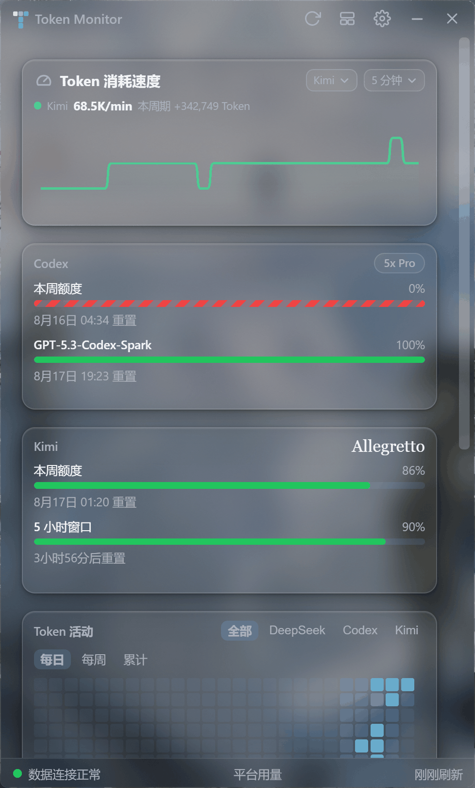
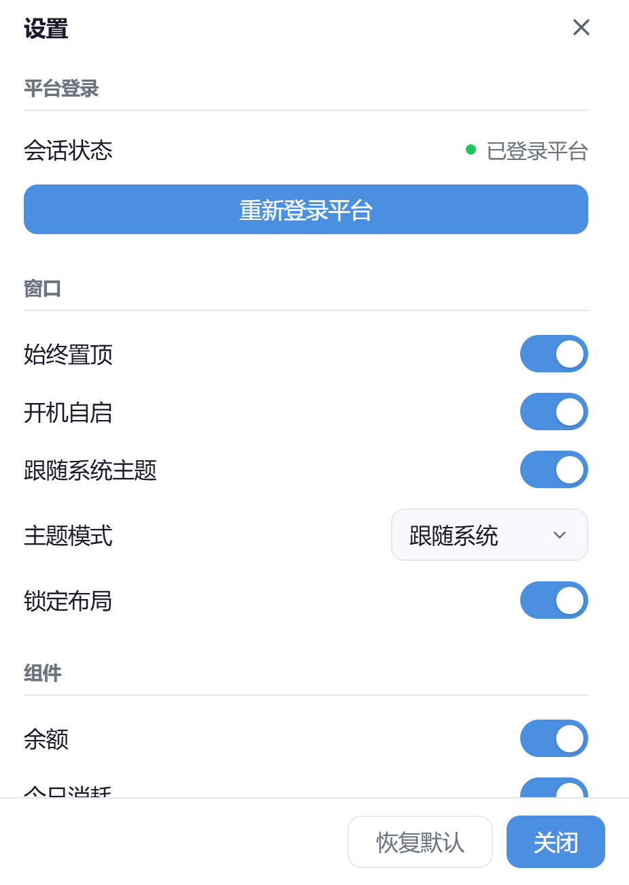

# Token Monitor

**中文** | [English](README.en.md)

多平台 AI 用量监控桌面悬浮窗——在同一个窗口里实时追踪 **DeepSeek**、**Codex（OpenAI）**、**Kimi** 的额度、余额与 Token 消耗，并汇总 **DeepSeek Harness（DSH）** 的本地或推送用量。



## 近期更新

- **主题、布局与图表体验完善**（2026-10）：修复亚克力切换、文字对比度、最大化拖拽还原与卡片测高抖动；ECharts 改为按需加载，并优化图表更新与资源清理。
- **DeepSeek 近 30 天花费**（2026-10）：余额卡新增近 30 天花费，自动补抓上月数据以覆盖跨月窗口；费用趋势图可展示约两个月的数据。
- **小深酱主题与 Kimi 网页额度**（2026-09）：新增带角色装饰、动态步态进度条与专属迷你窗的小深酱主题；Kimi 网页通道可读取 5 小时、本周与月度额度。
- **迷你模式与 WSL 日志探测**（2026-08）：新增余额／额度圆环与实时速度迷你窗、分页轮播及贴边速度柱；自动探测运行中 WSL 发行版的 Kimi 会话日志。
- **DSH 双通道采集**（2026-08）：支持本地遥测文件与 Bearer 鉴权推送，自动模式在推送活跃时停止文件轮询；用量汇入仪表盘、热力图、Token 速度与 MCP。

## 功能

### 平台额度看板

- **Codex**：本周额度与模型级窗口（如 GPT-5.3-Codex-Spark），右上角标注套餐（如 `5x Pro`），带重置倒计时。
- **Kimi**：本周、5 小时与月度额度窗口，网页通道优先、CLI 凭证兜底，带重置倒计时。
- **DeepSeek**：余额、今日消耗、缓存命中率与近 30 天花费。

### 图表

- **费用增长趋势**：每日费用柱状＋累计曲线。
- **Token 消耗趋势**：输出／缓存命中／缓存未命中堆叠。
- **DeepSeek 每日 Token 消耗**：按模型（pro／flash 等）堆叠的每日柱状图。
- **每日 Token 消耗**：DeepSeek、Kimi、Codex 三平台同图堆叠，与热力图同源。
- **Token 活动热力图**：GitHub 风格年度热力图，可按平台／每日／每周／累计切换，悬浮显示当日明细；支持 Harness 独立视图、当前视图总消耗与自适应可见月份。

#### Token 消耗速度

- 在设置 → 组件中开启“Token 消耗速度（会增加内存占用）”。
- 支持展示全部、DeepSeek、Codex、Kimi、DeepSeek Harness，以及 10 秒到 5 小时的八种滚动窗口。
- 曲线显示标准化后的 Token／分钟，悬停可查看本周期增量。
- 模块只在开启后开始计数；关闭会停止额外监听并清除最近 6 小时速度历史。

### 窗口与交互

- **Windows 11 亚克力磨砂＋圆角**：DWM 合成层绘制，缩放时圆角与窗口同步；原生边缘缩放，无延迟、无黑边；失焦不褪色。
- **主题模式**：跟随系统／日间／夜间／亚克力（亮）／亚克力（暗）／小深酱，主窗口与设置窗口联动切换。
- **迷你悬浮窗**：显示余额／额度圆环与实时 Token 速度，四个数据源按两行分页轮播、顺序可调；贴边收起为速度柱，双击速度柱恢复完整窗口。
- **贴边自动隐藏**：完整窗口可停靠屏幕左、右或上边缘，收起后悬停滑出；托盘唤醒或打开设置时自动完整展开。
- **自由布局**：点标题栏“编辑布局”图标后，每个卡片可拖拽换位、拉伸改尺寸；设置中可一键锁定。
- **组件显隐**：设置面板里按卡片开关显示内容。
- **网络代理**：系统代理（自动识别当前代理端口预填）／直连／自定义代理。
- **系统托盘**：显示／隐藏窗口、重新登录平台、打开设置、退出。
- 始终置顶、开机自启。



## 数据来源

| 平台 | 方式 |
| --- | --- |
| DeepSeek | API Key 查询余额；内置代理会话（首次需登录 DeepSeek 平台）获取用量明细 |
| Codex | 只读复用本机 Codex CLI 凭证查询额度；扫描活动与归档 rollout 日志统计用量 |
| Kimi | 网页会话读取 5 小时、本周与月度额度（CLI 凭证兜底）；只读扫描本机及运行中 WSL 的 Kimi CLI 会话日志 |
| DeepSeek Harness | 本地遥测文件（`~/.dsh/telemetry/usage-YYYY-MM-DD.jsonl`），或经本机 HTTP 接口接收 Bearer 鉴权推送；支持自动／仅文件／仅推送模式 |

用量聚合与历史数据均在本地处理，仅向对应平台官方接口发起查询；DSH 推送接收默认监听 `127.0.0.1`。

## 快速开始

环境要求:Node.js ≥ 18(推荐 20+)、npm ≥ 9。Windows 11 可获得完整的亚克力与圆角体验(Windows 10 退化为直角、无磨砂)。

```bash
npm ci
npm --prefix renderer ci
npm start                # 自动构建 renderer 并启动 Electron
```

`npm start` 会先执行 renderer 的生产构建。构建失败时 Electron 不会启动；如果绕过 npm 脚本直接启动 Electron，主进程也会在创建窗口前检查构建产物并明确退出。

首次启动会弹出登录窗口,输入 DeepSeek API Key(`sk-` 开头,在 [DeepSeek 开发者平台](https://platform.deepseek.com/api_keys) 创建),随后按提示完成平台登录即可。

### 常用命令

```bash
npm test                 # 运行全部测试(node --test)
npm run build:renderer   # 仅构建渲染层(React + Vite)
npm run dev:renderer     # 渲染层 Vite 开发服务器
npm run build:win        # 打包 Windows 安装包(electron-builder)
npm run build:mac        # 打包 macOS
npm run verify:codex-archive-usage -- --date 2026-08-09   # 只读验收 Codex 归档用量重建结果
```

`npm run verify:codex-archive-usage` 是对本机 Codex 活动/归档目录的一次只读影子重建:它只打印逐日聚合与计数,绝不写入 store、不修改任何 rollout 文件,也不输出会话内容、UUID 或完整私有路径。

## 技术栈

- **Electron 40** — 主进程、窗口与托盘
- **React 18 + Vite** — 仪表盘渲染层
- **ECharts 5** — 趋势 / 堆叠图表
- **gridstack 12** — 卡片自由布局
- **electron-store 8** — 设置与窗口状态持久化

## 项目结构

```
src/main/        Electron 主进程(窗口、托盘、IPC、数据调度)
src/preload/     预加载脚本(IPC 白名单)
src/renderer/    设置窗口、登录窗口等独立页面
renderer/        仪表盘 React 应用(Vite 构建到 renderer/dist)
test/            node --test 测试套件
docs/screenshots README 截图
```

## License

MIT
